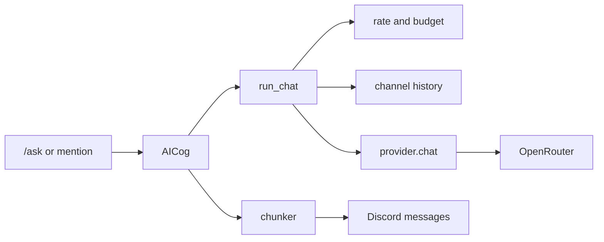

# AI chat

`/ask` and a message that mentions the bot both go through the same chat path. The path calls OpenRouter's OpenAI-compatible chat endpoint.



## Pieces

`bot/ai/provider.py` posts the messages and reads the reply text plus token counts.

A 429 or a 5xx status is tried again twice. A timeout, a connection error, or any other status stops after one try.

The error shown in Discord is a short sentence.

`bot/ai/persona.py` holds `DEFAULT_PERSONA`, the system prompt sent with every request.

`bot/ai/rate_limit.py` keeps a per-user request count and a per-user token total in memory.

The default request cap is 10 per minute. Set `AI_REQUESTS_PER_MINUTE` to change it.

The daily token budget defaults to 20000. The day resets at midnight UTC+7, using a fixed offset of 7 hours.

User ids in `OWNER_IDS` skip both checks.

`bot/ai/chunker.py` splits a reply longer than 2000 characters. It prefers a blank line, then a single line break. A code fence stays in one message when the fence fits.

`bot/ai/chat.py` remembers the last 10 turns for each channel. A turn is one user message and one assistant reply.

Each user turn is stored as `Name: text`.

The map keeps 200 channels and drops the oldest. The map is empty again when the process stops.

`bot/cogs/ai.py` is the Discord cog. It shows typing while it waits.

Outgoing messages pass `allowed_mentions` set to none. Echoed `@everyone`, role, and user text is sent as plain text.

## Configure

The bot reads these variables the same way it reads `TOKEN`. A value already set in the process environment is left as it is. Otherwise it is loaded from `.env` in the project root.

```
OPENROUTER_API_KEY=
AI_MODEL=deepseek/deepseek-v4.1-flash
AI_REQUESTS_PER_MINUTE=10
AI_DAILY_TOKEN_BUDGET=20000
OWNER_IDS=
```

`OWNER_IDS` is a comma-separated list of Discord user ids.

When `OPENROUTER_API_KEY` is empty, startup prints this line and continues without the cog:

```
OPENROUTER_API_KEY is not set. AI chat will not load.
```

Start the bot with:

```
python run.py
```

Slash commands are synced for all servers when the cog loads.

Discord may take time to show a new global slash command.

## Change the voice or the model

Edit `DEFAULT_PERSONA` in `bot/ai/persona.py`, then restart the bot.

Set `AI_MODEL` to another OpenRouter model id. The default is `deepseek/deepseek-v4.1-flash`.
