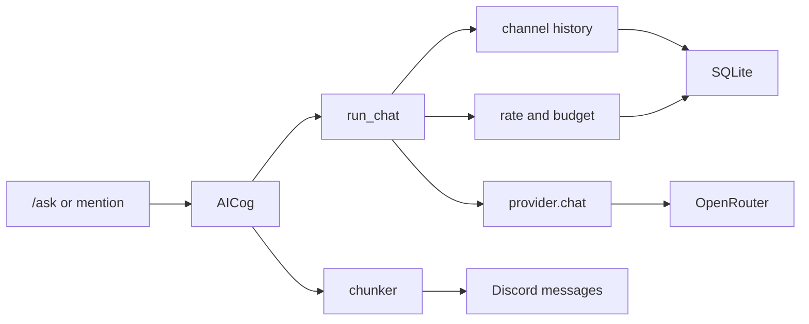

# AI chat

`/ask` and a message that mentions the bot both go through the same chat path. The path calls OpenRouter's OpenAI-compatible chat endpoint.

User messages sent to the AI are stored in the local SQLite file and sent to OpenRouter.



## Pieces

`bot/ai/provider.py` posts the messages and reads the reply text plus token counts.

A 429 or a 5xx status is tried again twice.

A 400 on a request that included reasoning settings is tried once more without those settings.

A timeout, a connection error, or any other status stops after one try.

The error shown in Discord is a short sentence.

If the reply text is empty and the finish reason is `length`, the bot shows this line:

```
The answer was cut off before it finished. Please ask for a shorter answer.
```

`AI_MAX_TOKENS` is sent as `max_tokens`. The default is 1024.

Reasoning tokens count toward `max_tokens`.

They also count toward the daily token budget, because the budget adds prompt and completion tokens as OpenRouter reports them.

`AI_REASONING_EFFORT` is `off`, `low`, `medium`, or `high`. The default is `low`.

`off` turns reasoning off.

`low`, `medium`, and `high` send that effort.

`bot/ai/persona.py` holds `DEFAULT_PERSONA`. A server with no saved persona uses that text as its persona.

`bot/ai/rate_limit.py` keeps a per-user request count in memory.

The daily token total is a row in SQLite.

The default request cap is 10 per minute. Set `AI_REQUESTS_PER_MINUTE` to change it.

The daily token budget defaults to 20000.

The day resets at midnight UTC+7, using a fixed offset of 7 hours.

User ids in `OWNER_IDS` skip both checks.

Token counts are not purged in this phase.

`bot/ai/chunker.py` splits a reply longer than 2000 characters. It prefers a blank line, then a single line break. A code fence stays in one message when the fence fits.

`bot/ai/chat.py` saves one row for each reply. The stored user line is the same text as the label, for example `Pim (id 4): hi`. The assistant reply is stored as the model wrote it.

The next request sends the last 10 rows for that channel, oldest first.

The system prompt starts with the persona. Speaker rules come next. They tell the model that each user message starts with a name and Discord id, to answer the person in the newest message, to call people by the name in the people list, and to follow the persona when older replies use another style.

In a server, one query loads saved names for the current user and for every user id in those rows.

The label and the people list use a saved name when that member has one. The display name is used when no name is saved.

A saved name is written as `- id 123: Pim (display name Ann)`. The part in parentheses is the display name.

With no saved name, the line is `- id 123: Ann`.

That display name is the newest one stored for the id.

The current speaker uses the display name from the message that just arrived.

A direct message has no server, so the label uses the display name.

After the reply is stored, a server reply for a member with no saved name adds this line:

```
-# You have not introduced yourself yet. Use /introduce to tell me what to call you.
```

The line is added for `/ask` and for mentions.

The turn is stored before that line is added. Later prompts see only the stored turn.

A mention of another user is sent as `@Ann (id 123)`.

When the message is a reply and the referenced message is available, the text starts with `Replying to Ann (id 123): "snippet"`. The quote is cut after 200 characters.

Rows older than `AI_HISTORY_DAYS` are left out of the request. The default is 7 days.

A write deletes expired rows, and that delete runs at most once an hour.

`bot/storage.py` opens the SQLite file at `BOT_DB_PATH`. The default is `data/bot.db` in the project root.

`data/` is listed in `.gitignore`.

A turn stores the speaker display name, the user id, the channel id, the guild id, the user message, the AI reply, and a timestamp.

A DM has no guild id.

The same file stores daily token counts, each server's persona text, and the name each member picks with `/introduce`.

`bot/cogs/ai.py` is the Discord cog. It shows typing while it waits.

Outgoing messages pass `allowed_mentions` set to none. Echoed `@everyone`, role, and user text is sent as plain text.

## Your stored turns

`/memory view` replies with how many of your turns are stored in this channel, plus your last 3 messages there.

```
/memory view
```

`/memory clear` deletes only your turns. The `scope` choice is `channel` or `everywhere`. `channel` is the default.

```
/memory clear scope: everywhere
```

`/memory wipe-channel` deletes every stored turn in this channel. It runs in a server and requires the Manage Messages permission.

```
/memory wipe-channel
```

These replies are visible only to the person who ran the command.

## Persona

`/persona show` replies with the persona for this server, and says whether it is the default or a custom one. It runs in a server.

A long persona is cut after 300 characters in that reply.

```
/persona show
```

`/persona set` stores a custom system prompt for this server. It requires the Manage Server permission.

It deletes this server's stored turns. Old replies are written in the previous voice, and the model copies that voice.

Empty text is rejected. Text longer than 1500 characters is rejected.

```
/persona set text: You are a helpful bot.
```

`/persona reset` deletes the saved persona for this server. It requires the Manage Server permission.

It then deletes this server's stored turns.

Later replies use `DEFAULT_PERSONA`.

When the server is already using the default persona, the stored turns stay.

```
/persona reset
```

Edit `DEFAULT_PERSONA` in `bot/ai/persona.py`, then restart the bot, to change the fallback text.

## Configure

The bot reads these variables the same way it reads `TOKEN`. A value already set in the process environment is left as it is. Otherwise it is loaded from `.env` in the project root.

```
OPENROUTER_API_KEY=
AI_MODEL=deepseek/deepseek-v4.1-flash
AI_REASONING_EFFORT=low
AI_MAX_TOKENS=1024
AI_REQUESTS_PER_MINUTE=10
AI_DAILY_TOKEN_BUDGET=20000
AI_HISTORY_DAYS=7
BOT_DB_PATH=
OWNER_IDS=
```

`OWNER_IDS` is a comma-separated list of Discord user ids.

`AI_REASONING_EFFORT` is `off`, `low`, `medium`, or `high`. The default is `low`.

`AI_MAX_TOKENS` is the completion limit for one reply. The default is 1024.

`AI_HISTORY_DAYS` is how many days of turns stay in the file. The default is 7.

`BOT_DB_PATH` is the SQLite file. An empty value uses `data/bot.db`.

A relative path starts at the project root.

When `OPENROUTER_API_KEY` is empty, startup prints this line and continues without the AI cogs:

```
OPENROUTER_API_KEY is not set. AI chat will not load.
```

`bot.cogs.ai`, `bot.cogs.memory`, and `bot.cogs.introduce` load only when that key is set.

`bot.cogs.help`, `bot.cogs.moderation`, and `bot.cogs.pdf` load on every startup.

Start the bot with:

```
python run.py
```

Startup syncs slash commands after those cogs load.

Set `DEV_GUILD_ID` to a server id to copy the commands to that server.

With `DEV_GUILD_ID` empty, the sync is global.

Discord may take time to show a new global slash command.

See `docs/commands.md`.

## Change the model

Set `AI_MODEL` to another OpenRouter model id. The default is `deepseek/deepseek-v4.1-flash`.
